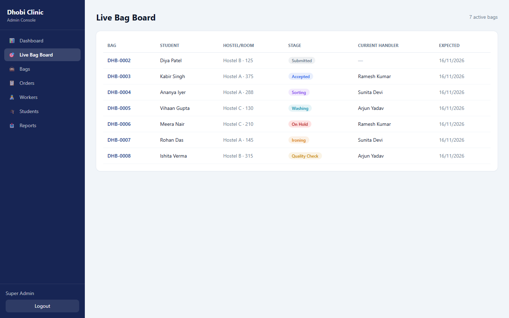
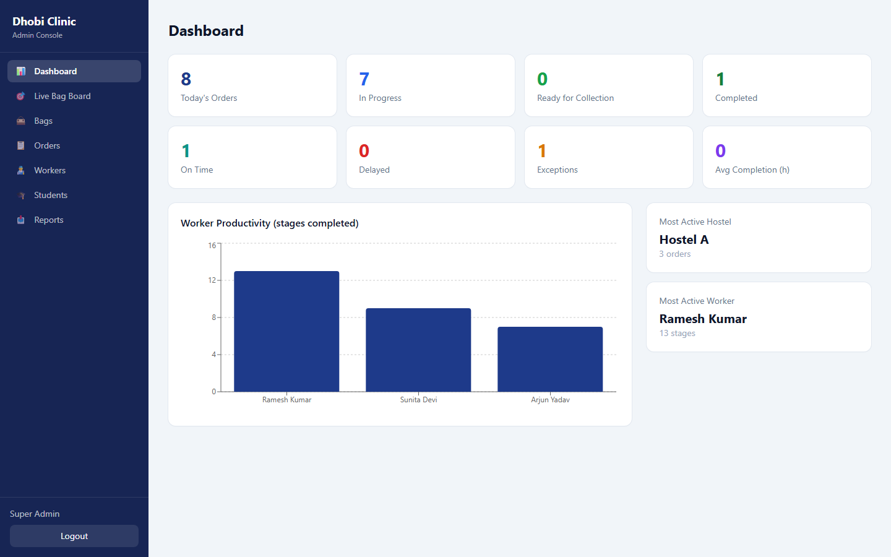
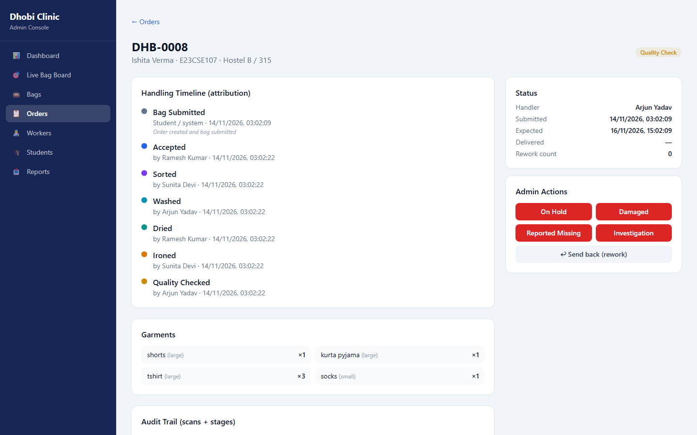

# Dhobi Clinic V2 — University Laundry Management Platform

Production-grade, accountability-first laundry workflow system for Bennett University.
Bag-level tracking · 10-stage workflow · per-stage worker attribution · OTP-verified delivery ·
audit trails · SLA + analytics · printable PDF bag labels.



| Admin dashboard | Order timeline with attribution |
|---|---|
|  |  |

<sub>Screenshots use a demo database with fictional students and staff, populated through the real API.</sub>

## Three apps, one API
| App | Folder | Stack | Users |
|-----|--------|-------|-------|
| **Backend API** | `dhobi-clinic-backend/` | Node + Express + PostgreSQL | — |
| **Mobile app** | `dhobi_clinic_app/` | Flutter | Students + Workers |
| **Admin dashboard** | `dhobi-clinic-admin/` | React + Vite + Tailwind | Admins |

---

## Prerequisites
- Node.js 18+ · PostgreSQL 14+ · Flutter 3.22+ (only for the mobile app)

---

## 1. Backend

```bash
cd dhobi-clinic-backend
npm install
```

Create `.env` (copy `.env.example`):
```
PORT=3000
DB_HOST=localhost
DB_PORT=5432
DB_NAME=dhobi_clinic
DB_USER=postgres
DB_PASSWORD=your_password
JWT_SECRET=any_long_random_string
JWT_EXPIRES_IN=7d
FIREBASE_SERVICE_ACCOUNT_JSON={}          # paste service-account JSON for push; {} disables push
LAUNDRY_OPEN_HOUR=10                       # submission window (production: 10 / 20)
LAUNDRY_CLOSE_HOUR=20
```

Create DB, run migrations, seed admin + item catalog:
```bash
psql -U postgres -c "CREATE DATABASE dhobi_clinic;"
node scripts/migrate.js
psql -U postgres -d dhobi_clinic -f seeds/seed.sql
npm run dev          # http://localhost:3000  (GET /health → {"status":"ok","version":"v2"})
```

**Default admin:** `admin@dhobiclinic.com` / `Admin@1234`

> ⚠️ Re-running `node scripts/migrate.js` wipes data (migration 001 drops/recreates). Run once on setup.

---

## 2. Admin Dashboard (web)

```bash
cd dhobi-clinic-admin
npm install
npm run dev          # http://localhost:5173
```
Log in with the admin account. Features: dashboard (stats + productivity chart + on-time/delayed),
live bag board, bags (bulk-generate + assign + label PDF), orders (filter, exceptions, rework, audit
trail), workers (productivity + score), students, CSV reports.

---

## 3. Mobile App (students + workers)

```bash
cd dhobi_clinic_app
flutter pub get
flutter run                 # device/emulator;  use a real device for camera QR scanning
```
- API base URL auto-selects: `localhost` on web/desktop, `10.0.2.2` on Android emulator
  (edit `lib/core/constants/api_constants.dart` for a physical device → your machine IP).
- **Students:** self-register, view permanent **Bag QR**, create requests (10 large + 5 small/day caps,
  acknowledgements), track laundry with **attribution timeline + ETA + collection OTP**, laundry history,
  notification preferences.
- **Workers:** scan a bag → see student + current stage → complete one stage (with remarks) → deliver
  with **student OTP**; workload + history.

---

## The Workflow
```
requested → submitted → accepted → sorting → washing → drying →
ironing → quality_check → ready_for_collection → delivered
```
- Worker scans the bag's **permanent QR** (encodes only an opaque token — no student data).
- Backend decides the next stage — **one stage per scan**, never skippable.
- **Optimistic concurrency + row lock**: simultaneous scans → exactly one advance.
- Each completion records **who + when** (the attribution timeline) + a scan-log (audit).
- At *Ready*, a 6-digit OTP is issued to the student; delivery requires that OTP.
- Admin-only **exceptions** (`on_hold / damaged / reported_missing / investigation`) block processing
  until cleared; **rework** sends a bag back one stage.
- Push notifications fire only for **accepted / ready / delivered / exceptions** (configurable).

## Bennett rules enforced
- 48–60 h turnaround (SLA = +60 h) · 10 large + 5 small = 15 garments/day · submission 10:00–20:00 ·
  one active order per bag · collection only via OTP.

---

## Tests

```bash
cd dhobi-clinic-backend && npm test     # Node's built-in test runner, no database needed
```

The workflow rules live in one pure module ([`src/modules/orders/rules.js`](dhobi-clinic-backend/src/modules/orders/rules.js)) so they can be tested without Postgres: stage order, the 10 + 5 = 15 daily garment caps, and the submission window. The window is checked in **campus time** (`LAUNDRY_TIMEZONE`, default `Asia/Kolkata`), because a cloud server's UTC clock would otherwise move 10:00–20:00 IST to 15:30–01:30 IST. Collection OTPs come from `crypto.randomInt` and are compared in constant time.

## Key API endpoints
| Method | Path | Role | Purpose |
|--------|------|------|---------|
| POST | /api/auth/register · /login | public | student signup / login |
| GET | /api/bags/scan/:qrToken | worker | resolve bag → student + active order |
| POST | /api/orders | student | create request (caps/window/acks enforced) |
| POST | /api/orders/:id/complete-stage | worker | advance one stage (sends `expected_stage`) |
| POST | /api/orders/:id/deliver | worker | OTP-verified delivery |
| GET | /api/admin/stats · /productivity · /live-board | admin | analytics |
| POST | /api/admin/orders/:id/exception · /rework | admin | exception / rework |
| GET | /api/admin/bags/:id/audit | admin | full lifecycle audit |
| GET | /api/admin/bags/:id/label.pdf · POST /api/admin/bags/labels.pdf | admin | PDF labels |
| GET | /api/admin/reports/orders.csv · /productivity.csv | admin | CSV reports |

## Notes / not yet configured
- **Push delivery** needs a Firebase project (paste service-account JSON into `.env`); in-app
  notifications + timeline work without it.
- **Camera QR scanning** needs a real Android device/emulator.
- Packaging an installable APK / iOS build is a future step.
